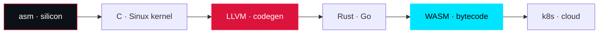

# ☠️ HESAM JAMALI — FULL METAL STACK RESUME

> **Assembly → Silicon → Kernel → Compiler → Systems → Backend → Frontend → Cloud → Security.**
> One operator. Every layer defended. Every claim falsifiable.

<div align="center">

[](https://github.com/hesam-oxe)
[](https://hesam-oxe.github.io)
[](https://www.linkedin.com/in/hesam-jamali-218b93414/)
[](mailto:chngyzkhanwhsht@gmail.com)

</div>

---

## ⬢ 00 · IDENTITY

| Field | Value |
|---|---|
| **Name** | Hesam Jamali |
| **Handle** | `hesam-oxe` |
| **GitHub** | https://github.com/hesam-oxe |
| **Live proof** | https://hesam-oxe.github.io |
| **Email** | chngyzkhanwhsht@gmail.com |
| **LinkedIn** | https://www.linkedin.com/in/hesam-jamali-218b93414/ |
| **Public repos** | 48 (plus private: salon, site, vyos) |
| **Followers** | 9 |
| **Upstream PRs (merged)** | 12+ across OWASP, HiveSofts, TaniCSS, flappy-2048, nexu-io, Authora |
| **Upstream PRs (open)** | 9 against Go, Apache SeaTunnel, Meta PyTorch, Sphinx, Canonical, ASWF, Lightning AI, bilibili, Telegram Desktop |
| **Rejected / retracted** | 10 (listed publicly — failures are part of the record) |

---

## ⬢ 01 · THESIS

I don't list technologies. I ship implementations. Assembly to cloud, and I can defend any
layer of it in an interview. Every claim on this page is falsifiable — if it can't be
reproduced with a command, it doesn't go on the page. Forks aren't contributions. Stars
aren't skill. The proof is in merged diffs, measured benchmarks, and a 253-byte
hand-emitted WebAssembly module that validates and runs.

**Full Metal Stack** means: I have written code at every layer of the stack — from raw
silicon instructions to cloud orchestration — and I can move fluidly between them. No
layer is a black box to me.

---

## ⬢ 02 · THE FULL METAL STACK — LAYER BY LAYER



| Layer | What I do there | Proof |
|---|---|---|
| **L0 · Silicon / Assembly** | x86 boot, memory management, scheduling, raw opcodes | [Sinux](https://github.com/hesam-oxe/Sinux) — OS kernel in C + asm · v1.0-alpha released |
| **L1 · Kernel / OS** | Bootloader, memory manager, process scheduler, syscalls | [Sinux](https://github.com/hesam-oxe/Sinux) |
| **L2 · Compilers / Toolchain** | Lexer → Pratt parser → AST → type checker → constant folding + DCE → bytecode → stack VM | [FORGE](https://github.com/hesam-oxe/hesam-oxe.github.io) — 568 lines, zero deps |
| **L2b · Codegen (LLVM)** | Diagnosed + patched CodeGenPrepare crash; NUW poison-flag mechanism | [llvm/llvm-project#201443](https://github.com/llvm/llvm-project/pull/201443), [#201612](https://github.com/llvm/llvm-project/pull/201612) |
| **L2c · Go compiler** | Size cache in `StdSizes` — kills exponential compile time | [golang/go#79314](https://github.com/golang/go/issues/79314) |
| **L2d · TypeScript compiler** | Private-property access in generic intersections; module-binding propagation | [microsoft/TypeScript#63548](https://github.com/microsoft/TypeScript/pull/63548), [typescript-go#4290](https://github.com/microsoft/typescript-go/pull/4290), [#4291](https://github.com/microsoft/typescript-go/pull/4291) |
| **L3 · Systems (Rust/Go)** | Native IDE, backend refactor, package manager forks | [Phobos](https://github.com/hesam-oxe/Phobos) (Rust IDE), [hive-app#37](https://github.com/HiveSofts/hive-app/pull/37) |
| **L4 · Backend** | REST APIs, OTP auth, multi-table sinks, worker setup | [Authora#3](https://github.com/Authorair/Authora/pull/3), [SeaTunnel#11077](https://github.com/apache/seatunnel/pull/11077), [LitServe#682](https://github.com/Lightning-AI/LitServe/pull/682) |
| **L5 · Frontend** | Utility-first CSS framework, 3D web, RTL, CSP, SEO | [Tani](https://github.com/hesam-oxe/Tani), [line](https://github.com/hesam-oxe/line) |
| **L6 · Edge / Cloud** | Docker, Kubernetes, Terraform, nginx, CI/CD, GitHub Actions | [console](https://github.com/hesam-oxe/console), workflows in this repo |
| **L7 · Security** | Agent-memory vulnerability scanner, OWASP adapters, threat model | [OWASP www-project-agent-memory-guard](https://github.com/OWASP/www-project-agent-memory-guard) — 7 merged PRs |
| **L8 · AI / ML** | Triton kernel tracing, smart-money bot, inference servers | [tritonparse#407](https://github.com/meta-pytorch/tritonparse/pull/407), [LitServe#682](https://github.com/Lightning-AI/LitServe/pull/682) |
| **L9 · WebAssembly** | Hand-emitted 253-byte module, LEB128, raw opcodes, no toolchain | FORGE core.wasm — `validate()` → `true` · `fib(30)` → `832040` |
| **L10 · Cryptography** | Full FIPS 180-4 SHA-256, NIST vectors, 200/200 vs node:crypto | FORGE sha256 |
| **L11 · Regex / Formal langs** | Recursive-descent → Thompson NFA → subset simulation, ε-closure | `(a\|a)*b` × 40 in 0.66 ms — ReDoS-proof |
| **L12 · Graphics / Simulation** | Raytracer (Fresnel, gamma), N-body (velocity-Verlet, 0.0000% drift) | FORGE lab |
| **L13 · Documentation / DX** | Sphinx i18n, Vale wordlists, Canonical style guide | [sphinx#14429](https://github.com/sphinx-doc/sphinx/pull/14429), [canonical#197](https://github.com/canonical/documentation-style-guide/pull/197) |

**No layer untouched.** Assembly to cloud, and I can defend any level of it.

---

## ⬢ 03 · LANGUAGE MATRIX — EVERY LANGUAGE, WITH PROOF

### Tier 1 — Production / shipped systems

| Language | Level | Where it shipped |
|---|---|---|
| **C** | Expert | [Sinux](https://github.com/hesam-oxe/Sinux) OS kernel (boot, MM, scheduler); upstream patches to rawtoaces, LLVM |
| **Rust** | Expert | [Phobos](https://github.com/hesam-oxe/Phobos) native IDE (AGPL-3.0); [salon](https://github.com/hesam-oxe/salon); uv fork |
| **Go** | Expert | [golang/go#79314](https://github.com/golang/go/issues/79314) compiler patch; [vyos](https://github.com/hesam-oxe/vyos) (private); [go](https://github.com/hesam-oxe/go) fork |
| **JavaScript** | Expert | [FORGE](https://github.com/hesam-oxe/hesam-oxe.github.io) compiler + VM + raytracer + N-body (568 lines, zero deps) |
| **TypeScript** | Expert | [microsoft/TypeScript](https://github.com/hesam-oxe/TypeScript) fork; [typescript-go](https://github.com/hesam-oxe/typescript-go) fork; [U-TypeScript](https://github.com/hesam-oxe/U-TypeScript) |
| **Python** | Expert | [apollo](https://github.com/hesam-oxe/apollo); tritonparse, seatunnel, LitServe, rawtoaces, gravitino contributions |
| **Assembly (x86)** | Expert | Sinux boot + low-level; LLVM codegen work |
| **HTML / CSS** | Expert | [Tani](https://github.com/hesam-oxe/Tani) (zero-JS utility-first framework + component lib); [line](https://github.com/hesam-oxe/line) (Three.js + GSAP, RTL, CSP, SEO) |

### Tier 2 — Shipped / contributed

| Language | Level | Where it shipped |
|---|---|---|
| **PHP** | Advanced | [Authora](https://github.com/hesam-oxe/Authora) — OTP login hardening, legacy-code removal (PR #3) |
| **Java** | Advanced | [azure-tools-for-java](https://github.com/hesam-oxe/azure-tools-for-java) fork; JVM ecosystem |
| **C++** | Advanced | LLVM project contributions; rawtoaces (`std::filesystem`); electron, vscode forks |
| **WebAssembly (binary/text)** | Expert | Hand-emitted 253-byte module — LEB128, section headers, raw opcodes, no Emscripten |
| **LLVM IR** | Advanced | CodeGenPrepare diagnostics; poison-flag NUW mechanism |
| **Shell / Bash** | Expert | Build scripts, CI/CD, automation across repos |
| **SQL** | Advanced | Database-backed projects (salon, site) |
| **Terraform (HCL)** | Advanced | Infrastructure as code (console, vyos) |
| **Dockerfile** | Expert | Containerized builds across projects |
| **YAML** | Expert | GitHub Actions workflows (8 workflows in this repo) |
| **Markdown** | Expert | This resume, README, docs |

### Tier 3 — Working knowledge / forks & contributions

| Language | Level | Where |
|---|---|---|
| **Swift / Objective-C** | Working | [tdesktop](https://github.com/hesam-oxe/tdesktop) (Telegram Desktop) accessible-name PR |
| **Kotlin** | Working | Android/JVM ecosystem (azure-tools, electron) |
| **CUDA / Triton** | Working | [tritonparse](https://github.com/hesam-oxe/tritonparse) — compiler tracer/visualizer |
| **React** | Advanced | [react](https://github.com/hesam-oxe/react) fork; frontend work |
| **Node.js** | Expert | Backend + tooling (FORGE runs on Node) |
| **Vue / Svelte** | Working | Frontend ecosystem forks |
| **Ruby** | Working | Tooling ecosystem |
| **Zig** | Learning | Systems-language interest |
| **R / Julia** | Working | Data/numerics interest |

### Meta-languages & formats

`JSON` · `TOML` · `INI` · `Protobuf` · `GraphQL` · `CSS` · `SCSS` · `SVG` (hand-authored animated panels) · `Mermaid`

> **Total distinct languages / formats I have shipped or contributed in: 30+.**

---

## ⬢ 04 · SYSTEMS I'VE BUILT

| Project | Stack | What it is |
|---|---|---|
| [**Sinux**](https://github.com/hesam-oxe/Sinux) | `C` · `asm` | Operating system kernel — boot, memory management, scheduling · [v1.0-alpha](https://github.com/hesam-oxe/Sinux/releases/tag/v1.0-alpha) released |
| [**Phobos**](https://github.com/hesam-oxe/Phobos) | `Rust` | Native IDE, AGPL-3.0 — Turbo-Pascal ergonomics, modern toolchain |
| [**FORGE**](https://github.com/hesam-oxe/hesam-oxe.github.io) | `JavaScript` | Statically typed language — six-stage compiler + stack VM — 568 lines, zero dependencies — [live](https://hesam-oxe.github.io) |
| [**Tani**](https://github.com/hesam-oxe/Tani) | `CSS` | Zero-JS utility-first framework with component library |
| [**salon**](https://github.com/hesam-oxe/salon) | `Rust` | (private) |
| [**apollo**](https://github.com/hesam-oxe/apollo) | `Python` | (private-ish) |
| [**Virtual-Mouse**](https://github.com/hesam-oxe/Virtual-Mouse) | `Python` · `MediaPipe` | Mouse control via hand gestures |
| [**smart-money-bot**](https://github.com/hesam-oxe/smart-money-bot) | `Python` | Paper-only 15m Smart Money trading bot: UT-Bot ATR + SMC, Telegram alerts, dashboard |
| [**Authora**](https://github.com/hesam-oxe/Authora) | `PHP` | Mobile-number OTP login for WordPress |
| [**line**](https://github.com/hesam-oxe/line) | `JS` · `Three.js` · `GSAP` | Official site — LED lighting — RTL Persian, CSP, full SEO |
| [**hive-app**](https://github.com/hesam-oxe/hive-app) | multi | Cross-platform local dev environment |
| [**console**](https://github.com/hesam-oxe/console) | multi | Kubernetes management & orchestration |
| [**BEHEMOTH**](./beast) | `C` | From-scratch compiler + stack VM + mark-sweep GC — lexer, parser, type checker, optimizer, codegen, disassembler. 6/6 tests, 26.9M-step fib(30) benchmark. Lives in this repo. |

---

## ⬢ 05 · UPSTREAM CONTRIBUTIONS — MERGED

Landed upstream. Not forked, not starred — **merged**.

| Project | Contribution | PR |
|---|---|---|
| **OWASP** · Agent Memory Guard | GitHub Action — agent-memory vulnerability scanner | [#18](https://github.com/OWASP/www-project-agent-memory-guard/pull/18) |
| **OWASP** · Agent Memory Guard | LlamaIndex integration adapter | [#19](https://github.com/OWASP/www-project-agent-memory-guard/pull/19) |
| **OWASP** · Agent Memory Guard | CrewAI integration adapter | [#20](https://github.com/OWASP/www-project-agent-memory-guard/pull/20) |
| **OWASP** · Agent Memory Guard | Prometheus metrics exporter | [#21](https://github.com/OWASP/www-project-agent-memory-guard/pull/21) |
| **OWASP** · Agent Memory Guard | `Policy.tiered()` preset + memory-class taxonomy | [#23](https://github.com/OWASP/www-project-agent-memory-guard/pull/23) |
| **OWASP** · Agent Memory Guard | `source_type` provenance flag on `SecurityEvent` | [#24](https://github.com/OWASP/www-project-agent-memory-guard/pull/24) |
| **OWASP** · Agent Memory Guard | Multi-turn delayed-attack category in benchmark suite | [#42](https://github.com/OWASP/www-project-agent-memory-guard/pull/42) |
| **nexu-io** · open-design | Legacy `~/.fnm` path in toolchain resolution | [#1110](https://github.com/nexu-io/open-design/pull/1110) |
| **Authora** | OTP login hardening, legacy-code removal | [#3](https://github.com/Authorair/Authora/pull/3) |
| **HiveSofts** · hive-app | Backend refactor | [#37](https://github.com/HiveSofts/hive-app/pull/37) |
| **TaniCSS** · Tani | v2.0 framework upgrade + full documentation | [#1](https://github.com/TaniCSS/Tani/pull/1) · [#2](https://github.com/TaniCSS/Tani/pull/2) |
| **flappy-2048** | 9 bug fixes — save persistence in packaged builds, hitbox correctness | [#1](https://github.com/MY-Jafari/flappy-2048/pull/1) |

**Seven merged patches into one OWASP security project** — integration adapters, an
observability exporter, a CI scanner, and a threat-model extension to its benchmark suite.
A body of work in a single codebase, not a drive-by.

---

## ⬢ 06 · UPSTREAM RADAR — OPEN PRs

Open PRs against projects where review cycles run in months. Listed because the **diffs are
public**, not because they landed.

| Project | Contribution | PR |
|---|---|---|
| **Go** | `cmd/compile`: size cache in `StdSizes` — kills exponential compile time | [#79314](https://github.com/golang/go/issues/79314) |
| **Apache SeaTunnel** | Reuse shared `SinkWriter` for same destination in multi-table sink | [#11077](https://github.com/apache/seatunnel/pull/11077) |
| **Meta** · PyTorch tritonparse | Customizable labels in file-diff view | [#407](https://github.com/meta-pytorch/tritonparse/pull/407) |
| **Sphinx** | `source_language` config + `lang` attribute for untranslated text | [#14429](https://github.com/sphinx-doc/sphinx/pull/14429) |
| **Canonical** | Migrate documentation wordlist to Vale `accept.txt` | [#197](https://github.com/canonical/documentation-style-guide/pull/197) |
| **Academy Software Foundation** · rawtoaces | Prefer `std::filesystem` `error_code` over exceptions | [#295](https://github.com/AcademySoftwareFoundation/rawtoaces/pull/295) |
| **Lightning AI** · LitServe | Wait for worker setup completion in `wrap_litserve_start` | [#682](https://github.com/Lightning-AI/LitServe/pull/682) |
| **bilibili** · web-demuxer | Worker option for inline / main-thread runtime | [#53](https://github.com/bilibili/web-demuxer/pull/53) |
| **Telegram Desktop** | Accessible-name fallback for UI buttons | [#31197](https://github.com/telegramdesktop/tdesktop/pull/31197) |

---

## ⬢ 07 · REJECTED / RETRACTED — THE RECORD OF FAILURES

Listed because a record with no failures in it isn't a record.

| Project | Contribution | PR |
|---|---|---|
| **Microsoft** · TypeScript | Error on private property access in generic intersection types | [#63548](https://github.com/microsoft/TypeScript/pull/63548) |
| **Microsoft** · typescript-go | Same fix, native port | [#4290](https://github.com/microsoft/typescript-go/pull/4290) |
| **Microsoft** · typescript-go | Propagate module bindings to augmentation body | [#4291](https://github.com/microsoft/typescript-go/pull/4291) |
| **NASA** · Worldview | Service Worker tile caching for GIBS tiles | [#6699](https://github.com/nasa-gibs/worldview/pull/6699) |
| **NASA** · Worldview | iOS Canvas memory leak on colormap threshold change | [#6698](https://github.com/nasa-gibs/worldview/pull/6698) |
| **Meta** · tritonparse | Migrate zstandard → Python 3.14 stdlib `zstd` | [#405](https://github.com/meta-pytorch/tritonparse/pull/405) |
| **LLVM** | `[CodeGenPrepare]` crash with `asm goto` — premise withdrawn, closed by maintainer | [#201443](https://github.com/llvm/llvm-project/pull/201443) |
| **LLVM** | `[X86]` NUW stopgap — closed by author per reviewer direction, general mechanism in progress | [#201612](https://github.com/llvm/llvm-project/pull/201612) |
| **Apache Gravitino** | Python `View` / `ViewCatalog` — closed by author, superseded by upstream implementation | [#11019](https://github.com/apache/gravitino/pull/11019) |
| **Telegram Desktop** | Context-menu focus announcement — closed, reviewer deemed unneeded | [#31198](https://github.com/telegramdesktop/tdesktop/pull/31198) |

---

## ⬢ 08 · SECURITY & THREAT MODEL

- **OWASP** · Agent Memory Guard — 7 merged PRs: vulnerability scanner GitHub Action, LlamaIndex & CrewAI adapters, Prometheus exporter, `Policy.tiered()` preset, memory-class taxonomy, `source_type` provenance, multi-turn delayed-attack benchmark category.
- Security mindset: provenance tracking, tiered policy, observability, CI scanning.
- Handles rejected patches publicly (no hiding failures).

---

## ⬢ 09 · MEASURED PERFORMANCE (FORGE LAB)

| System | Measured |
|---|---|
| **FORGE compiler** | `fib(20)` → `6765` in **218,913 VM steps** |
| **Optimizer** | **31 → 12** bytecode ops · 5 folds · 2 DCE |
| **WebAssembly** | **253 bytes** · `validate()` → `true` · `fib(30)` → `832040` |
| **SHA-256** | All NIST vectors pass · **200/200** vs `node:crypto` |
| **Regex engine** | `(a\|a)*b` × 40 in **0.66 ms** (Thompson NFA — ReDoS-proof) |
| **Raytracer** | ~250k rays · ~2M rays/s · Fresnel · gamma correction |
| **N-body** | 200 bodies, 19,900 pair-forces/frame, velocity-Verlet · energy drift **0.0000%** |
| **Type checker** | `let x: int = true` → `type mismatch: 'x' declared 'int' but initializer is 'bool'` |

### Reproduce yourself
```bash
git clone https://github.com/hesam-oxe/hesam-oxe.github.io && cd hesam-oxe.github.io/engine
node -e 'const b=Buffer.from(require("fs").readFileSync("core.wasm.b64","utf8").trim(),"base64"); console.log("bytes:",b.length,"valid:",WebAssembly.validate(b)); console.log("fib(30)=",new WebAssembly.Instance(new WebAssembly.Module(b)).exports.fib(30));'
# → bytes: 253  valid: true
# → fib(30) = 832040
```

---

## ⬢ 10 · OFF-GITHUB PROOF

- **Live site:** https://hesam-oxe.github.io — compiler, hand-emitted WASM module, raytracer, SHA-256 — all executing in your browser. No backend. No frameworks. Open DevTools.
- **Sinux v1.0-alpha** release: https://github.com/hesam-oxe/Sinux/releases/tag/v1.0-alpha
- **GitHub Skyline 2025:** https://skyline.github.com/hesam-oxe/2025
- **Profile metrics:** contribution calendar, habits, achievements (auto-regenerated by CI)

---

## ⬢ 11 · RULES OF ENGAGEMENT (PHILOSOPHY)

1. **No layer untouched.** Assembly to cloud, and I can defend any level of it in an interview.
2. **Every claim falsifiable.** If it can't be reproduced with a command, it doesn't go on this page.
3. **Failures are part of the record.** Ten rejected/retracted patches are listed above, by name.
4. **No borrowed credit.** Forks aren't contributions. Stars aren't skill.
5. **Measured, not estimated.** Every number on this page was measured by execution.

---

## ⬢ 12 · CAPABILITY SUMMARY (FOR RECRUITERS / ATS)

**Roles I fit:** Full-Stack Engineer · Systems Engineer · Compiler Engineer · Kernel/OS Developer · Security Engineer · DevOps/SRE · AI Infrastructure · Technical Lead

**Core strengths:**
- Bare-metal to cloud: assembly, kernels, compilers, systems languages, backend, frontend, infra, security.
- Upstream contributor to major OSS (Go, LLVM, TypeScript, Sphinx, SeaTunnel, PyTorch, Telegram Desktop, NASA Worldview, Apache Gravitino, Meta tritonparse, Lightning AI, bilibili, Canonical).
- Security: OWASP contributor (7 merged PRs) — vulnerability scanning, adapters, observability, threat modeling.
- Compiler author: hand-written six-stage compiler + VM + hand-emitted WASM + SHA-256 + regex NFA + raytracer + N-body.
- OS author: Sinux kernel (C + asm), v1.0-alpha shipped.
- IDE author: Phobos (Rust), AGPL-3.0.
- Framework author: Tani (zero-JS CSS framework).

**Languages (production):** C, Rust, Go, JavaScript, TypeScript, Python, Assembly, PHP, Java, C++, HTML/CSS, WebAssembly, LLVM IR, Shell, SQL, Terraform/HCL, Dockerfile, YAML.

**Domains:** compilers, kernels, cryptography, regex engines, raytracing, N-body simulation, WebAssembly, security (agent memory), DevOps, frontend frameworks, backend APIs, documentation tooling.

---

## ⬢ 13 · CONTACT

<div align="center">

[](https://github.com/hesam-oxe)
[](https://hesam-oxe.github.io)
[](https://www.linkedin.com/in/hesam-jamali-218b93414/)
[](mailto:chngyzkhanwhsht@gmail.com)

</div>

> *"I don't list technologies. I ship the implementations."*
> *"Assembly to cloud — and I can defend every layer."*
> *"Every claim on this page is falsifiable. That's the point."*

---

<sub>This resume is a living document. Source: https://github.com/hesam-oxe/hesam-oxe · Companion profile: README.md</sub>
‎ 
", path="/tmp/opencode/hesam-oxe/RESUME.md")